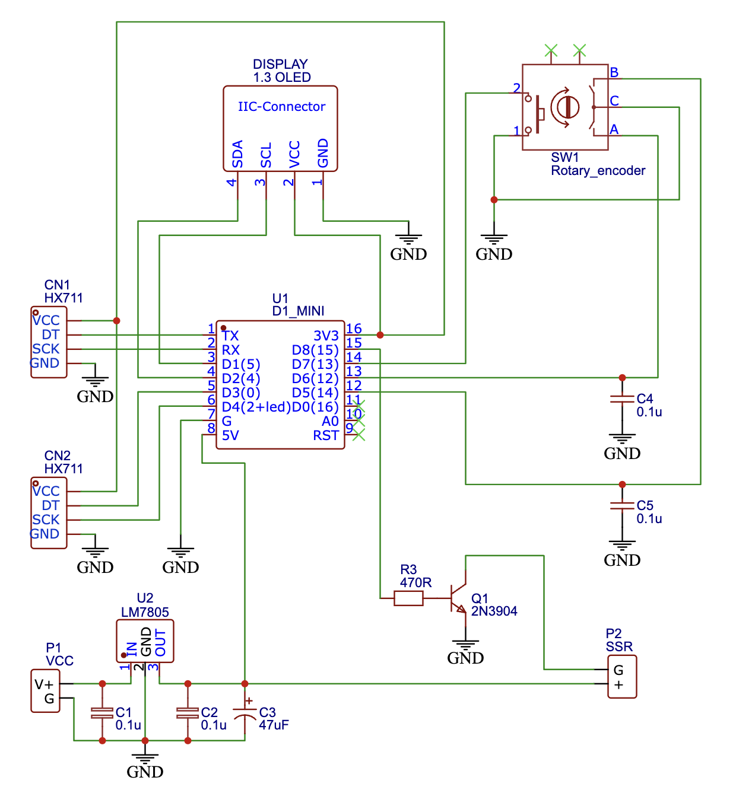

# Built-in Scale for Rancilio Silvia

Automatic espresso scale for the Rancilio Silvia. Measures extraction weight in real-time and stops the pump when the target weight is reached, accounting for post-flow overshoot.

**Board:** Wemos D1 Mini (ESP8266)

## Hardware

- 2x 1kg HX711 load cells (summed)
- SH1106 128x64 OLED display (I2C)
- Rotary encoder with push button
- Relay on D8 (solenoid valve + pump control)
- WiFi for OTA updates, web UI, and MQTT

## Circuit Diagram



## 3D Printed Parts

Load cell mounts: [Printables model](https://www.printables.com/model/897813-rancilio-silvia-loadcell-mount-slide-on-10mm-screw)


Additional component housings in [housing_models/](./housing_models).

## Build & Upload

Requires `arduino-cli` (bundled in Arduino IDE):

```bash
# Compile
"/Applications/Arduino IDE.app/Contents/Resources/app/lib/backend/resources/arduino-cli" \
  compile --fqbn esp8266:esp8266:d1_mini --libraries ~/Documents/Arduino/libraries coffee_machine_scale.ino

# Upload (OTA)
"/Applications/Arduino IDE.app/Contents/Resources/app/lib/backend/resources/arduino-cli" \
  upload --fqbn esp8266:esp8266:d1_mini --port <DEVICE_IP> coffee_machine_scale.ino
```

WiFi and MQTT credentials go in `~/Documents/Arduino/libraries/credentials/credentials.h` — see `HOME_ASSISTANT_MQTT.md`.

## Features

- **Auto-stop extraction** — stops pump at target weight minus configurable overshoot (post-flow compensation)
- **Correction time** — configurable initial settling period (default 1.2s) to ignore vibration after pump starts
- **Settling delay** — waits 3s after pump stops for remaining liquid, then locks final weight on display
- **Shot profile** — records weight every 200ms; viewable as a chart in the web UI
- **Dual portafilter support** — separate overshoot settings for naked/spouted, single/double
- **Web UI** at `http://<IP>/` — configure dose targets, overshoot, view shot profile and logs
- **MQTT** — publishes state under `coffee_scale/`, extraction events as JSON (weight, time, dose type, stop reason)
- **OTA updates** — flash new firmware over WiFi
- **Offline-capable** — WiFi timeout (15s); scale and extraction work without network
- **Watchdog** — hardware WDT resets device if firmware locks up during extraction (relay fails safe to LOW)
- **EEPROM validation** — magic byte detects uninitialized memory and writes sensible defaults

## Web API

| Endpoint | Description |
|----------|-------------|
| `GET /` | Web settings UI |
| `GET /api/status` | JSON with all settings and device state |
| `GET /api/send?cmd=<command>` | Set values (e.g. `setSingleDose:36000`) |
| `GET /api/profile` | Last shot profile as JSON array |
| `GET /log` | Timestamped log file |

## MQTT Topics

All under `coffee_scale/`. See [HOME_ASSISTANT_MQTT.md](./HOME_ASSISTANT_MQTT.md) for full integration guide.

## UI Navigation

- **Rotate** — navigate menus, adjust values
- **Press** — select / confirm
- **Long press** — edit dose target (from menu) or overshoot (from portafilter menu)
- Auto-sleep after 5 minutes; any input wakes the display
